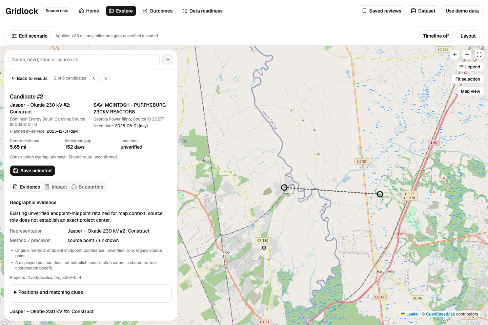
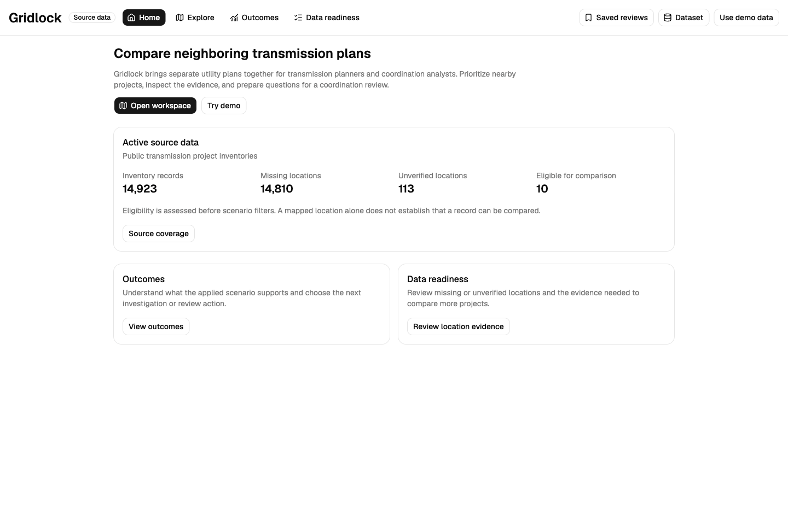
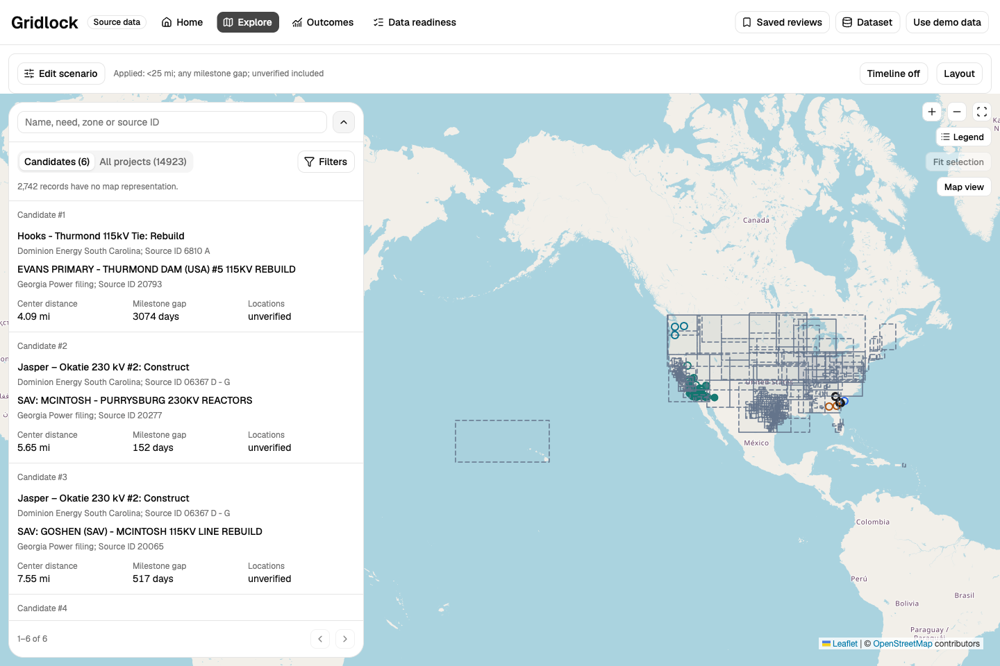
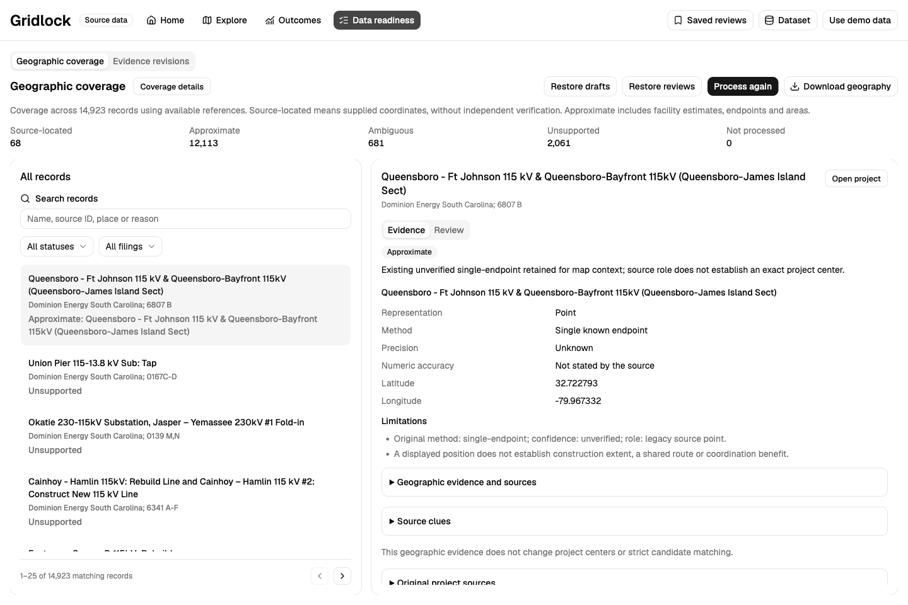
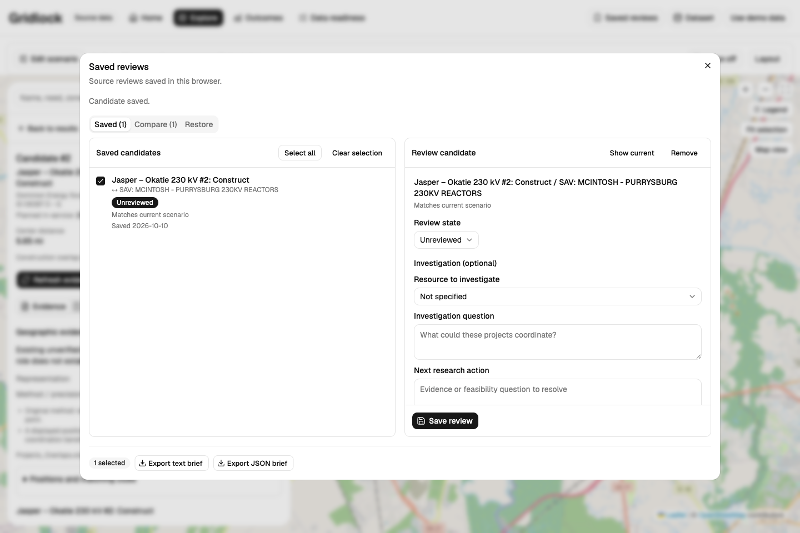

# Gridlock

Find nearby transmission projects, compare their evidence, and prepare coordination reviews.

Gridlock brings public utility plans into one workspace for transmission planners and coordination analysts. Search the inventory, investigate potential overlaps, and export a brief with the sources and questions needed for a follow-up review.



*A source-data comparison: 5.65 miles between supplied centers and 152 days between planning milestones. Locations are unverified; a shared route and construction overlap remain unknown.*

[Quick start](#quick-start) · [First review](#your-first-coordination-review) · [Screenshots](#screenshots) · [Data and limits](#data-and-limits) · [Development](#development) · [Documentation](#documentation)

## What it does

- **Find projects:** search by name, source ID, reporting group, project need, or planning zone. Records without coordinates remain searchable.
- **Compare candidates:** inspect distance, milestone separation, source references, and uncertainty together.
- **Explore geography:** distinguish source points, approximate locations, geographic extents, and unresolved evidence.
- **Investigate a result:** save candidate evidence, notes, an investigation question, and a next research action.
- **Share a review:** export readable text or restorable JSON briefs, plus separate dataset and geography backups.

The app runs locally in your browser. It needs no backend, application account, API key, or paid service. Internet access supplies the map basemap; bundled records and analysis run locally.

## Quick start

### Prerequisites

- Node.js **24.x**, or **22.x at version 22.18 or later**, with npm.
- Git and access to this private repository.

### Install and run

```sh
git clone https://github.com/safuentees/gridlock-coordination.git
cd gridlock-coordination/app
npm ci
npm run dev -- --host 127.0.0.1
```

Open the URL Vite prints, normally **http://127.0.0.1:5173**. You should see **Home**, the **Source data** badge, and the active inventory summary. Allow the initial source download and geographic processing to finish.

If you use the GitHub CLI, authenticate with an account that has repository access and replace the clone command with:

```sh
gh auth login
gh repo clone safuentees/gridlock-coordination
```

Choose **Try demo** or **Use demo data** to explore a separate synthetic collection. The app labels demo mode explicitly and never substitutes it for failed source loading.

## Your first coordination review

1. From **Home**, choose **Open workspace**. In **Explore**, switch between **Candidates** and **All projects**; use search and **Filters** to narrow the results.
2. Open the **Jasper–Okatie / McIntosh–Purrysburg** candidate. Its supplied centers are about **5.65 miles** apart, with **152 days** between an in-service milestone and a need-date milestone. Read **Evidence** before drawing a conclusion.
3. Use **Edit scenario** to adjust the radius, milestone-gap limit, or inclusion of unverified locations, then choose **Apply scenario**. The default radius is strictly **less than 25 miles**. **Timeline** shows date context; **Outcomes** explains what the applied scenario supports.
4. Choose **Save selected**, then open **Saved reviews**. Record the investigation question, next research action, review state, and notes. Choose **Save review** before exporting.
5. Check the saved candidate's checkbox and choose **Export text brief** for a readable handoff, or **Export JSON brief** to restore the review later through **Saved reviews → Restore**. Clicking its title opens the editor; the checkbox controls export selection.

For example, an investigation question might be: “Could these projects share staging space?” The next action would be to confirm access, construction windows, and the relevant asset owners with source evidence.

**Back to results** restores your browsing context. Switching workspaces preserves the mounted views and current drafts.

### Improve location evidence

Open **Data readiness → Geographic coverage** to inspect the automatic processing results. Each record has a geographic representation or an explanation of why it remains ambiguous or unsupported. Review the sources, then accept, reject, or correct the representation with evidence. **Coverage details** explains the precision and gaps.

Use **Evidence revisions** for cited project-location or ownership updates. Preview a change before applying it. **Dataset → Revisions** lets you download or preview a complete normalized source revision. Geographic context stays separate from the stricter candidate calculation.

### Keep a portable backup

Saved work belongs to this browser and origin. Saved reviews use localStorage; source revisions, geographic reviews, and unfinished geographic drafts use IndexedDB. Changing the hostname or port uses a different storage origin.

| Work to preserve | Download or restore from |
| --- | --- |
| Candidate evidence, notes, and investigation questions | **Saved reviews**: export a JSON brief; restore through **Restore** |
| Active source dataset | **Dataset → Revisions** |
| Geographic results and completed reviews | **Data readiness → Geographic coverage**: **Download geography** / **Restore reviews** |
| Unfinished geographic review drafts | **Data readiness → Geographic coverage**: **Download drafts** / **Restore drafts** |

Download a backup before clearing browser storage or moving to another browser. Storage failures are reported in the app. Restoring a brief previews conflicts and does not replace the active dataset or scenario.

## Screenshots

These are actual desktop captures using the bundled **Source data**, at 1440 × 960. The comparison above and the views below show the same application; counts change when you apply revisions. [Capture details and refresh steps](docs/screenshots/README.md).

### Home: understand the collection



*The entry screen separates inventory size from eligibility for comparison.*

### Explore: browse candidates and the map



*Candidate rows show the two projects, source IDs, distance, milestone gap, and location confidence. Geographic extents provide context rather than surveyed project boundaries.*

### Data readiness: inspect geographic evidence



*Approximate and unresolved records stay visible. The selected record exposes its location method, uncertainty, and source evidence.*

### Saved reviews: prepare a brief



*Save your research question and next action alongside the candidate's evidence, then export a brief.*

## Data and limits

### What is included

The bundled collection currently contains:

| Collection | Contents |
| --- | --- |
| Source data | **14,923 source observations** across 31 declared regional source scopes and the original 252 Dominion/Georgia filing records |
| Supplied locations | **113 map centers**, all unverified; **14,810 records** lack a resolved center in the source dataset |
| Strict comparison | **10 eligible records**, producing **6 candidates** under the default scenario |
| Synthetic demo | **13,200 synthetic records**, kept separate from source data |

Source observations include transmission projects and planning or capital-project context. They are **not a deduplicated count of engineering projects**. Importing a complete declared source scope does not establish complete state or national coverage. Consult **Source coverage** in the app and the [US coverage register](specs/us-coverage/README.md) for editions, inclusion rules, and known gaps.

Geographic processing adds cited context from bundled references: supported points, facility estimates, endpoints, or geographic extents. A record may be represented on the map while still lacking a location suitable for strict comparison. **Source-located** describes provenance, not independent verification; **approximate** can mean a town, county, state, or region.

### How to read a result

| Result | Meaning |
| --- | --- |
| Candidate distance | Straight-line haversine distance between eligible supplied centers; ranked by distance, then known milestone gap, then stable identity |
| Milestone gap | Separation between source milestones when both have day precision; enabling a gap filter excludes unknown or partial dates |
| Construction overlap | Established only from explicit construction windows; milestone proximity alone is insufficient |
| Inventory eligibility | Requires transmission-project scope, eligible lifecycle as of the source edition, a qualified center, and cited owner identity; owner identity must also support the pair comparison |
| Legacy filing comparison | Preserves cross-filing semantics; a reporting utility and an asset sponsor can differ |
| Exploratory proximity | A separate view of approximate points, endpoints, or area relationships; area relationships do not establish a radius-qualified distance |
| Impact estimate | Hypothetical avoided land cost based on your shared-length, width, land-cost, and avoided-share assumptions |

Plans are historical source snapshots, not live schedules. An elapsed date does not establish completion. Proximity does not establish a shared corridor, simultaneous construction, engineering feasibility, or verified savings. Missing values and unresolved evidence remain explicit.

## Development

### Stack

| Area | Tools |
| --- | --- |
| Application | React, TypeScript, Vite |
| Interface | Tailwind CSS, shadcn/ui with Radix |
| Standard map | Leaflet, react-leaflet, OpenStreetMap |
| Experimental map | MapLibre, react-map-gl, deck.gl; choose **Map view → Experimental** |
| Data contracts | Zod validation, normalized JSON, local geographic references |
| Offline ingestion | Python scripts; optional for running the bundled app |

### Commands

Run these inside `app/`:

| Command | Purpose |
| --- | --- |
| `npm run dev -- --host 127.0.0.1` | Start the local development server |
| `npm run build` | Validate the TypeScript projects and create a production build |
| `npm run preview -- --host 127.0.0.1` | Preview an existing production build |
| `node --import tsx scripts/check-core.ts` | Check the representative source pair, strict radius boundary, and hypothetical impact calculation |

The core check is a bounded example, not a complete audit of source coverage or browser interactions. Generated output in `app/dist/` stays out of Git.

### Project layout

```text
app/src/
  core/           Candidate eligibility, distance, timing, and impact
  domain/         Validated data contracts and geographic types
  data/           Source/demo collections, references, and persistence
  enrichment/     Geographic processing and evidence review
  features/       Home, Explore, Outcomes, readiness, and briefs
  components/     Shared interface components
app/scripts/      Bounded verification scripts
scripts/          Source ingestion and reference preparation
specs/            Mission, technical agreements, coverage, and roadmap
docs/screenshots/ README images and capture instructions
```

Running the app does **not** require the original PDFs or workbooks. To reproduce ingestion, follow the [baseline ingestion guide](scripts/ingest/README.md) and the relevant [regional adapter guide](scripts/ingest/coverage/). Original inputs, credentials, dependencies, and generated builds must stay out of Git.

### Troubleshooting

| Symptom | What to do |
| --- | --- |
| Clone returns “Repository not found” | Confirm repository access and the signed-in GitHub account; use the GitHub CLI clone option above |
| Installation reports an unsupported engine | Check `node --version` against the prerequisites, then rerun `npm ci` |
| First load or geography takes time | Let the bundled JSON assets load and processing finish; use the retry action if loading fails |
| Basemap is blank | Check internet access and OpenStreetMap tile requests |
| No candidates after changing filters | Check the radius, milestone limit, location-confidence setting, and project filters; **All projects** still shows the searchable inventory |
| Browser storage cannot save | Download the affected work using the backup actions above before leaving the session |
| Port 5173 is occupied | Open the alternate URL printed by Vite; browser storage is separate for each port |

## Documentation

- [Mission and scope](specs/mission.md)
- [Technical contracts and data meanings](specs/tech-stack.md)
- [Source discovery and original evidence](specs/discovery.md)
- [US source coverage and gaps](specs/us-coverage/README.md)
- [Geographic reference sources](specs/features/F28-geographic-enrichment/references.md)
- [Roadmap](specs/roadmap.md) and [changelog](CHANGELOG.md)

## Help and contributions

Maintainer: [@safuentees](https://github.com/safuentees).

For a bug or data issue, [open an issue](https://github.com/safuentees/gridlock-coordination/issues) with the data mode, relevant source/project IDs, reproduction steps, and expected behavior. Include source locators for proposed data corrections; keep private information and credentials out of reports.

Before contributing, read [AGENTS.md](AGENTS.md) and the applicable technical agreements. Keep changes focused, preserve evidence and uncertainty, and include relevant verification with a pull request.

## License

This repository does not currently include a project license. Third-party libraries and source materials retain their own terms.

## README references

This README follows [GitHub's official README guidance](https://docs.github.com/en/repositories/managing-your-repositorys-settings-and-features/customizing-your-repository/about-readmes) and adapts the overview, setup, usage, and contribution structure of [Best-README-Template](https://github.com/othneildrew/Best-README-Template) and [Standard README](https://github.com/RichardLitt/standard-readme). The latter two are community resources. Images and documentation use repository-relative links, following [GitHub's formatting guidance](https://docs.github.com/en/get-started/writing-on-github/getting-started-with-writing-and-formatting-on-github/basic-writing-and-formatting-syntax#relative-links).
